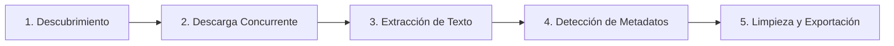

# Web Scraper de Discursos, Diarios de Debates e Informes

Conjunto de herramientas de **Web Scraping en Python** diseñadas para extraer, limpiar y estructurar discursos parlamentarios, diarios de debates e informes institucionales en un esquema tabular estandarizado (`.csv` y `.xlsx`).

El proyecto implementa distintas estrategias de extracción (**Trafilatura**, **Newspaper3k**, **Playwright** y **Extracción Universal con BeautifulSoup + PyPDFium2**) para adaptarse tanto a portales con documentos en PDF como a sitios web dinámicos o en HTML.

---

## 📋 Tabla de Contenidos

1. [Fuentes Soportadas](#-fuentes-soportadas)
2. [Estructura del Proyecto](#-estructura-del-proyecto)
3. [¿Cómo Funciona el Pipeline?](#-cómo-funciona-el-pipeline)
4. [Esquema del Dataset de Salida](#-esquema-del-dataset-de-salida)
5. [Requisitos e Instalación](#-requisitos-e-instalación)
6. [Cómo Correr los Scripts](#-cómo-correr-los-scripts)
7. [Notas Técnicas y Solución de Problemas](#-notas-técnicas-y-solución-de-problemas)

---

## 🌐 Fuentes Soportadas

1. **Diario de los Debates del Senado de la República (`senado.gob.mx`)**
   - Extrae sesiones de las Legislaturas **LXIV (2018–2021)**, **LXV (2021–2024)** y **LXVI (2024–presente)**.
   - Soporta extracción directa desde el HTML de la gaceta parlamentaria y descarga automática de PDFs como *fallback*.
2. **Diario de los Debates del Congreso del Estado de Jalisco (`infolej.congresojal.gob.mx`)**
   - Recorre las Legislaturas **LX, LXI, LXII, LXIII y LXIV**.
   - Descarga los archivos PDF de cada sesión y extrae su contenido página por página.
3. **Repositorio Institucional del ITESO — REI (`rei.iteso.mx`)**
   - Colección de Informes de Rectoría (DSpace 7), con detección automática multinivel del autor/rector por metadatos, expresiones regulares y período rectoral.

---

## 📁 Estructura del Proyecto

```text
web-scraper/
├── scrapers/
│   ├── scrapper.py               # Punto de entrada CLI del scraper universal
│   ├── scrapper_universal.py     # Scraper base (Requests + BeautifulSoup + PyPDFium2)
│   ├── scrapper_trafilatura.py   # Scraper con motor Trafilatura (soporta Senado e Infolej)
│   ├── scrapper_newspaper.py     # Scraper con motor Newspaper3k (orientado a artículos)
│   └── scrapper_playwright.py    # Scraper dinámico con navegador headless (Playwright)
├── datasets/                     # Archivos de salida generados (.csv y .xlsx)
├── scratch/                      # Scripts de prueba, diagnóstico y caché HTML local
│   └── cache_senado/             # Caché de sesiones del Senado para acelerar re-ejecuciones
├── deteccion_automatica_autor    # Documentación de la estrategia de detección de autor (REI)
└── README.md
```

---

## ⚙️ ¿Cómo Funciona el Pipeline?

Todos los scrapers siguen un flujo de procesamiento en **5 etapas**:



### 1. Descubrimiento y Catalogación
- **Infolej (Congreso de Jalisco):** Envía peticiones `POST` por cada legislatura (`LX` a `LXIV`) o interactúa con el formulario mediante **Playwright** para obtener los enlaces `.pdf` y fechas de cada sesión.
- **Senado de la República:** Consulta los índices de las legislaturas (`LXIV`, `LXV`, `LXVI`) en `/66/diario_de_los_debates/<LEG>/` y `/informacion/diario/`, catalogando los identificadores únicos de sesión (`sid`).

### 2. Descarga Concurrente y Caché
- Utiliza `ThreadPoolExecutor` (entre 10 y 16 hilos en paralelo) para acelerar la descarga de cientos de sesiones.
- En el caso del Senado (`scrapper_trafilatura.py`), guarda y reutiliza copias locales en `scratch/cache_senado/sesion_<sid>.html` para evitar peticiones repetidas y manejar límites de tasa (*rate limits*).

### 3. Extracción de Texto Crudo (`text-original`)
- **Documentos PDF:** Se procesan en memoria con `pypdfium2` utilizando un candado de concurrencia (`PDF_LOCK`) para garantizar seguridad entre hilos y corrigiendo problemas de codificación (`latin-1` vs `utf-8`).
- **Documentos HTML:** Se extrae la estructura del debate excluyendo barras de navegación y menús laterales.

### 4. Detección Automática de Metadatos (`speaker`, `role`, `date`, `context`)
- **Identificación de Orador/Presidente (`speaker`):** Analiza los primeros 3,000–4,000 caracteres de la sesión mediante expresiones regulares para identificar quién preside la sesión (ej. `Dip. <Nombre>` o `Sen. <Nombre>`). Si no aparece explícitamente, asigna como *fallback* institucional la `Mesa Directiva` correspondiente.
- **Normalización de Fechas (`date`):** Convierte fechas en formato `DD-MM-YYYY` o fechas en texto en español (ej. *"15 de septiembre de 2024"*) al estándar ISO `YYYY-MM-DD`.

### 5. Limpieza del Cuerpo Principal (`text_clean`) y Exportación
- **Motores de extracción:**
  - `scrapper_trafilatura.py` emplea `trafilatura.extract()` para separar el cuerpo del discurso del *boilerplate* (encabezados repetitivos o tablas de directorio).
  - `scrapper_newspaper.py` emplea `newspaper.Article` para parsear el texto como artículo limpio.
- **Post-procesamiento y normalización:**
  - Corrección de *mojibake* (caracteres mal codificados como `ó` -> `ó`).
  - Normalización Unicode (`NFC`) y eliminación de caracteres invisibles (`\xad`, `\ufeff`, `\u200b`).
  - Reconstrucción de palabras divididas por guion al final de línea (`re-\nforma` -> `reforma`).
  - Eliminación de colofones editoriales (*Tiraje*, *Diseño y formación*, *Impresión*, *Directorio*) y números de página sueltos.
  - Sanitización de caracteres de control ilegales en Excel y exportación automática a `.xlsx` y `.csv` (codificación `utf-8-sig` para compatibilidad directa con Microsoft Excel).

---

## 📊 Esquema del Dataset de Salida

Todos los scripts generan archivos `.csv` y `.xlsx` con las siguientes **8 columnas** estandarizadas (`dataset_base`):

| Columna | Tipo | Descripción | Ejemplo |
| :--- | :--- | :--- | :--- |
| `id` | `string` | Identificador secuencial por legislatura o colección | `DD-LXIV-001` |
| `language` | `string` | Código ISO del idioma del documento | `es` |
| `speaker` | `string` | Nombre del presidente de la Mesa Directiva o autor | `Sen. Gerardo Fernández Noroña` |
| `role` | `string` | Cargo institucional y legislatura correspondiente | `Presidente de la Mesa Directiva / LXVI Legislatura del Senado de la República` |
| `date` | `string` | Fecha de la sesión o publicación en formato `YYYY-MM-DD` | `2024-09-01` |
| `context` | `string` | Título de la sesión, periodo, año legislativo y órgano | `Sesión Plenaria, Primer Periodo Ordinario...` |
| `text-original` | `string` | Texto íntegro extraído del documento original (PDF/HTML) | *(Texto completo sin recortar)* |
| `text_clean` | `string` | Cuerpo principal limpio, normalizado y sin *boilerplate* | *(Texto limpio listo para análisis NLP)* |

---

## 🛠 Requisitos e Instalación

### 1. Requisitos previos
- **Python 3.10** o superior.
- Conexión a internet para consultar los portales oficiales.

### 2. Instalar dependencias de Python
Desde la raíz del proyecto, instala las librerías necesarias (se recomienda usar un entorno virtual `venv`):

```powershell
# Crear y activar entorno virtual (opcional pero recomendado)
python -m venv .venv
.\.venv\Scripts\Activate.ps1

# Instalar dependencias
pip install requests pandas openpyxl beautifulsoup4 lxml pypdfium2 trafilatura newspaper3k lxml_html_clean playwright urllib3
```

### 3. Instalar el navegador para Playwright
Si vas a utilizar `scrapper_playwright.py`, instala el binario de Chromium:

```powershell
playwright install chromium
```

---

## 🚀 Cómo Correr los Scripts

Todos los scrapers se encuentran en la carpeta [`scrapers/`](file:///c:/Users/PC/OneDrive%20-%20ITESO/Iteso/11vo%20semestre/PAP%20II/Proyectos/web-scraper/scrapers) y aceptan dos argumentos por línea de comandos:
- `--url`: URL objetivo a extraer.
- `--output`: Ruta y prefijo del archivo de salida (sin extensión; el script generará automáticamente tanto `.csv` como `.xlsx`).

### 1. Scraper con Trafilatura (Senado de la República / Congreso de Jalisco)
Es el scraper más completo y rápido. Detecta automáticamente si la URL pertenece al **Senado de la República** (`senado.gob.mx`) o al **Congreso de Jalisco** (`infolej.congresojal.gob.mx`).

**Extraer el Diario de los Debates del Senado (LXIV, LXV y LXVI):**
```powershell
python scrapers/scrapper_trafilatura.py --url "https://www.senado.gob.mx/66/diario_de_los_debates/LIV/" --output "../datasets/diario_debates_senado_trafilatura"
```
*(También puedes ejecutarlo sin argumentos `python scrapers/scrapper_trafilatura.py`, ya que el Senado y esa ruta de salida son su configuración por defecto).*

**Extraer el Diario de los Debates del Congreso de Jalisco con Trafilatura:**
```powershell
python scrapers/scrapper_trafilatura.py --url "https://infolej.congresojal.gob.mx/consulta/DiarioDeDebates.php" --output "../datasets/diario_debates_trafilatura"
```

---

### 2. Scraper Universal (Requests + PyPDFium2)
Extrae y limpia mediante reglas heurísticas y expresiones regulares todas las sesiones en PDF del Congreso de Jalisco:

```powershell
python scrapers/scrapper.py --url "https://infolej.congresojal.gob.mx/consulta/DiarioDeDebates.php" --output "../datasets/diario_debates"
```
*(Nota: Cuando `--output` es una ruta relativa, se resuelve respecto a la carpeta `scrapers/`, o bien puedes pasar una ruta absoluta).*

---

### 3. Scraper con Newspaper3k
Utiliza el motor de parseo de artículos de `newspaper3k` junto con la limpieza de PDFs:

```powershell
python scrapers/scrapper_newspaper.py --url "https://infolej.congresojal.gob.mx/consulta/DiarioDeDebates.php" --output "../datasets/diario_debates_newspaper"
```

---

### 4. Scraper Dinámico con Playwright
Abre un navegador Chromium *headless*, selecciona dinámicamente cada legislatura en el menú desplegable (`select[name='C_Legis']`), hace clic en buscar y descarga las sesiones resultantes:

```powershell
python scrapers/scrapper_playwright.py --url "https://infolej.congresojal.gob.mx/consulta/DiarioDeDebates.php" --output "../datasets/diario_debates_playwright"
```

---

## 💡 Notas Técnicas y Solución de Problemas

- **Archivos abiertos en Excel / OneDrive (`PermissionError`):** Si tienes el archivo `.csv` o `.xlsx` abierto en Excel mientras corre el script, `scrapper_trafilatura.py` reintentará guardar hasta 5 veces y, si continúa bloqueado, guardará automáticamente una copia de respaldo con el sufijo `_completo.csv` para no perder el progreso.
- **Certificados SSL Gubernamentales:** Los portales gubernamentales frecuentemente presentan certificados SSL incompletos; los scripts desactivan las advertencias de `InsecureRequestWarning` (`verify=False`) para evitar interrupciones en la descarga.
- **Uso de Caché en Senado:** Si necesitas forzar la redescarga desde cero de las sesiones del Senado, elimina el contenido de la carpeta `scratch/cache_senado/`.
